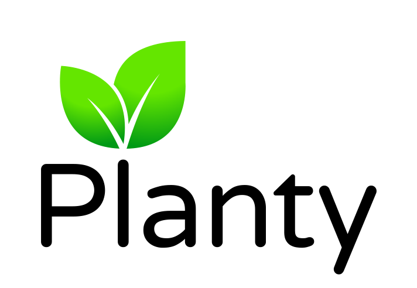

<p align="center">
    
</p>

> "I have <i>plenty</i> things to do!"

Planty is an open-source task management app inspired by Todoist and GTD system.

This project is being **actively developed** and is not yet a fully working product.


## How to run

Prerequisites: Docker (with compose plugin)

```
git clone https://github.com/m-danya/planty
cd planty
cp .env.sample .env
echo -e "\nPLANTY_AUTH_SECRET=$(openssl rand -base64 32)" >> .env
# change other secrets in .env

# TODO: Use Alembic to create the database, empty file won't work
# create here planty.db (see below one-liner with pytest for now)

docker compose up -d

docker exec -it planty-backend-1 uv run python -m planty.scripts.create_admin
```

Open `http://localhost` to access the app.

## Development notes

### How to run backend and frontend locally

Prerequisites:

- Docker (with compose plugin)
- [uv](https://docs.astral.sh/uv/)
- nvm

```
git clone https://github.com/m-danya/planty
cd planty
cp .env.dev.sample .env.dev
echo "\nPLANTY_AUTH_SECRET=$(openssl rand -base64 32)" >> .env.dev

uv sync

# Run Alembic migrations
# uv run alembic upgrade head

# Alembic migrations are not being maintained yet due to a high pace of changes
# during initial development. To get db with sample data from tests, uncomment a
# line in `config.py` to avoid using in-memory db for tests and run this:
uv run pytest planty/application && cp -f planty_test.db planty.db

# run "FastAPI" configuration in VS code or:
uv run uvicorn planty.main:app --reload
```

To start the frontend, run the following commands:

```
cd frontend
npm i
npm run dev
```

The production frontend is a static SvelteKit build. `npm run build` writes it
to `frontend/build`; the frontend Docker image serves those files with Caddy
and does not run Node.js.

Use [nvm](https://github.com/nvm-sh/nvm) to manage nodejs versions:

```
nvm install --lts 20
nvm use 20
```

### Switching between database engines

By default, the SQLite engine is used for persistence, but you can easily switch
to PostgreSQL: change `DB_TYPE` in `.env` file to `postgresql` and run
the system with `docker compose compose.yaml --profile with-postgres up -d`.

### Run tests and type checking

```
uv run pytest
uv run mypy planty
```

Measuring code coverage:

```
uv run coverage run -m pytest
uv run coverage report # or "uv run coverage html"
```

### Run linting & formatting

(or just use Ruff extension for VS Code)

```
uv run ruff check --extend-select I --fix
uv run ruff format
```

### Generate types for frontend from openapi.json

The Svelte frontend keeps its small typed API wrapper in `frontend/src/lib/api.ts`.

### History of the project

Planty started in 2024 as a pet project developed without coding agents: a
self-hosted, open-source task manager inspired by Todoist and GTD. The original
goals were to put Domain-Driven Design into practice and to build an alternative
to Todoist's task limits.

Later that year, as the backend became more complete, I used ChatGPT to help me
try building the frontend in Next.js. Coding agents had not become widespread
yet, so I used ChatGPT and copied the frontend code manually.

Now, in 2026, after coding agents had advanced significantly, I decided to
rebuild the frontend from scratch with their help, this time using SvelteKit.

Here is a demo of the original Next.js frontend from December 12, 2024, kept as
a snapshot of the project's history:

https://github.com/user-attachments/assets/6e2622b6-cec3-46f8-bd35-dc2c760b33b0

<!-- TODO: Record and add an up-to-date demo of the SvelteKit frontend. -->
